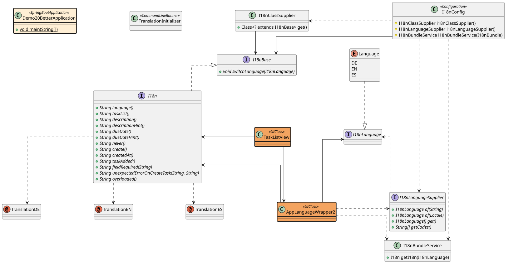
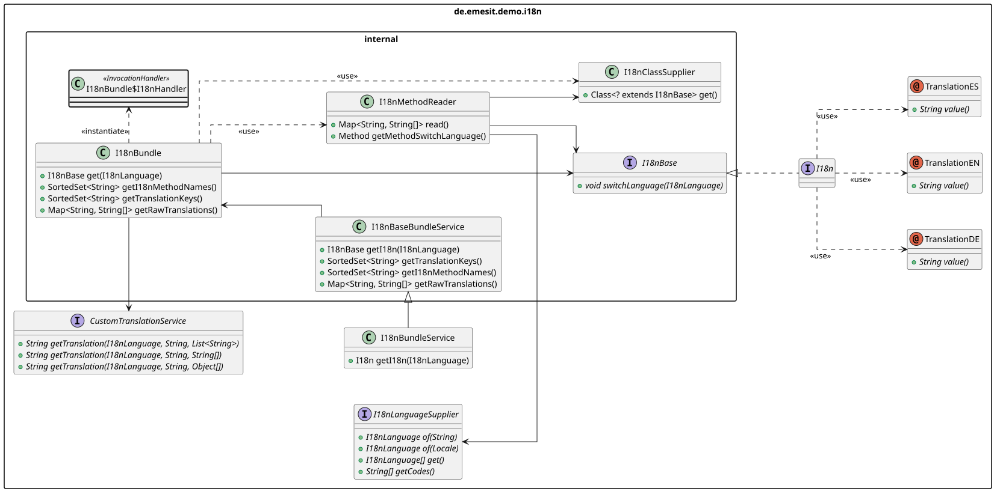

# "A Type Safe I18N Solution with Vaadin Flow"

## Rüdiger Schobbert

### at VaadinCreate 2026

---

### Demo Project 20
This project is similar to Demo Project 15. Compared to Project 15, it
* (also uses Java 21, Springboot 4 and Vaadin 25)
* use I18nLanguage interface
* has an optional TranslationService, which overrides the annotated translations in I18n interface
* has two controllers which can be used to get/set basic information
* has a complete set of Spring / JUnit tests

### Reference Documentation
For further reference, please consider the following:

* [Official Vaadin v25 Documentation](https://vaadin.com/docs/v25)
* [Official SpringBoot 4.1 Documentation](https://docs.spring.io/spring-boot/4.1.1/gradle-plugin/packaging-oci-image.html)
* [Official Gradle 8.14 Documentation](https://docs.gradle.org/8.14.6/userguide/userguide.html)

### UML Diagrams

#### Application Overview:

#### Package Overview UML over i18n/internal packages:

